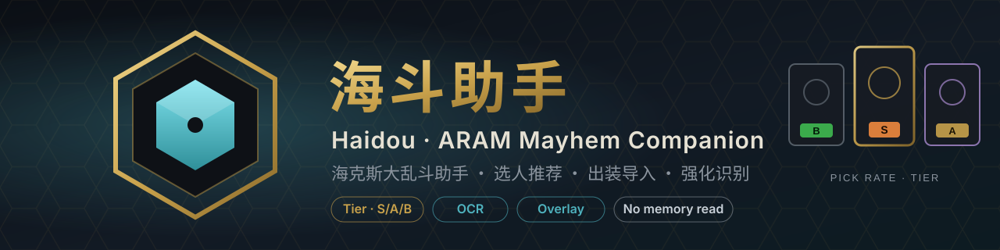

<p align="center">
  
</p>

<p align="center">
  <a href="README.md">简体中文</a> · <b>English</b>
</p>

<p align="center">
  <a href="https://github.com/Stya-hr/haidou/actions/workflows/portable.yml"></a>
  <a href="https://github.com/Stya-hr/haidou/releases"></a>
  <a href="LICENSE"></a>
  
  
  
  
  <a href="https://arammeta.com/?ref=haidou"></a>
</p>

<p align="center">
  A League of Legends <b>ARAM: Mayhem</b> companion: champion-select advice, one-click item-set import, augment OCR and an in-game tier overlay.<br>
  <b>Lightweight</b> (~50 KB frontend, Rust backend) · <b>Instant</b> (event-driven) · <b>Policy-friendly</b> (no memory reading, no injection, no input automation)
</p>

---

## ✨ Features

| | Feature | Details |
|---|---|---|
| ✅ | **Auto-accept** | Configurable delay, off by default |
| 🧭 | **Champion advice** | Bench sorted by rating, the stronger pick highlighted, one-click swap or reroll; tier list when idle |
| 📊 | **Win rate · Tier · Pick rate** | Champions: S+/S/A/B/C/D tier + win rate + pick rate; augments: tier + pick rate |
| 🛠️ | **Build archetypes** | e.g. "AP burst": core items → common follow-ups, with tier, win rate and pick rate; plus boots, situational items and augment styles |
| 📥 | **Item-set import** | Writes a client item set that shows up in the in-game shop; one block per archetype; optional auto-import once your champion is final |
| ✨ | **Summoner spells** | One click or automatic (off by default) |
| 🔍 | **Augment OCR** | Scans at game start, on level-ups (3/7/11/15) and while dead, or on hotkey `Ctrl+Shift+A`; matches **Simplified Chinese (both CN and Garena/SEA translations), Traditional Chinese and English** names |
| 🪟 | **In-game overlay** | Tier and pick rate under each augment card; transparent, always-on-top, click-through |
| 📦 | **Portable** | Unzip and run; all data lives in `haidou-data/` next to the executable |

> Runes are **disabled** in ARAM: Mayhem ([Riot Support](https://support.riotgames.com/en-us/league-of-legends/events/league-of-legends-aram-mayhem-game-mode)), so there is no rune import.

## 📦 Download & usage

1. Download `haidou-vX.Y.Z-win-x64.zip` from [Releases](https://github.com/Stya-hr/haidou/releases) and extract it to any **writable** folder (not Program Files).
2. Run `haidou.exe`. It connects automatically once the League client is running.
3. Play in **Borderless** or **Windowed** mode. Exclusive fullscreen prevents augment recognition and hides the overlay.
4. Augment OCR uses Windows' built-in OCR. To install the language component: Settings → Time & language → Language & region → Chinese (Simplified/Traditional) or English → Language options → Optical character recognition.
5. Delete the folder to uninstall completely.

Requires Windows 10/11 with WebView2, which is usually preinstalled.

## 🛡️ Fair play & anti-cheat

Haidou only uses methods Riot allows for third-party tools. There is nothing to "evade", and the code contains no detection-evasion logic:

- **No game-memory access, no injection, no hooks, no simulated input.** The game process is never opened. The game window is located by class name and captured the same way screen recorders do it (GDI).
- Client credentials come from the client's own `lockfile`. In game, Haidou only reads Riot's official [Live Client Data API](https://developer.riotgames.com/docs/lol#game-client-api) for your level and dead/alive state.
- Follows the [Riot developer policy](https://developer.riotgames.com/docs/lol): **augment win rates are never displayed.** Source augment win rates are only used locally to derive tiers and are never stored or shown. Champion and item-build win rates are allowed and are shown.
- Recommendations are highlights only; you make every choice. Item-set import only touches Haidou's own sets and leaves yours alone.

> ⚠️ The LCU (the League client's local API) is not officially supported by Riot and may change with client updates. Real-time augment hints during a game are a policy grey area, so OCR can be turned off in Settings. **Use at your own risk.**

## 📚 Data sources

| Data | Source | Notes |
|---|---|---|
| Champions, augments, items, spells | [CommunityDragon](https://raw.communitydragon.org) | Cached per patch; the data language follows the client |
| Win rate, tiers, pick rate, archetypes | [AramMeta](https://arammeta.com/?ref=haidou) | Used under its data terms: a clickable credit wherever its numbers appear; the index is fetched once per patch; champion details are fetched only when needed and cached; raw tables are never stored or exported |
| Custom | Local or remote JSON | Settings → Stats source; format: [`samples/mayhem-stats.sample.json`](samples/mayhem-stats.sample.json) |

## 🔧 Build from source

Requires Windows, Rust (MSVC toolchain), Node 20+ and pnpm:

```bash
pnpm install
pnpm tauri dev      # development
pnpm portable       # builds dist-portable/haidou-vX.Y.Z-win-x64.zip
```

- Tests: `cd src-tauri && cargo test`
- Type-check the Windows target from Linux: `cargo check --target x86_64-pc-windows-msvc`
- CI: [`.github/workflows/portable.yml`](.github/workflows/portable.yml) runs on manual dispatch; pushing a `v*` tag publishes a Release

<details>
<summary><b>Project layout</b></summary>

```
src-tauri/src/
  lcu/          client discovery, REST, WebSocket (3 events only), champ select / ready check / auto-import / locale
  arammeta.rs   AramMeta adapter: tier derivation, archetypes, caching
  data.rs       CommunityDragon sync, multilingual augment names, on-demand champion details
  apply.rs      item sets (one block per archetype) / summoner spells
  live.rs       in-game level and death state (triggers OCR)
  ocr/          scan scheduling, CN/TW/EN fuzzy matching, OCR engine rotation, overlay; win.rs = GDI capture + Windows.Media.Ocr
  paths.rs      portable data directory
src/            frontend (App.tsx main window, Overlay.tsx overlay)
scripts/        zip packaging
```

</details>

## 🙏 Acknowledgements

- [AramMeta](https://arammeta.com/?ref=haidou): ARAM: Mayhem statistics
- [CommunityDragon](https://www.communitydragon.org/): static game data and icons
- [Tauri](https://tauri.app/) · [SolidJS](https://www.solidjs.com/)

## 📄 License & legal

The code is released under the [MIT](LICENSE) license. Third-party data (AramMeta, CommunityDragon) is governed by its own terms and is not covered by the MIT license.

Haidou isn't endorsed by Riot Games and doesn't reflect the views or opinions of Riot Games or anyone officially involved in producing or managing Riot Games properties. Riot Games, and all associated properties are trademarks or registered trademarks of Riot Games, Inc. This project is not affiliated with AramMeta.
