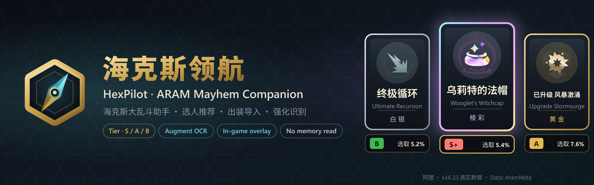

<p align="center">
  
</p>

<p align="center">
  <b>简体中文</b> · <a href="README.en.md">English</a>
</p>

<p align="center">
  <a href="https://github.com/Stya-hr/hexpilot/actions/workflows/portable.yml"></a>
  <a href="https://github.com/Stya-hr/hexpilot/releases"></a>
  <a href="LICENSE"></a>
</p>
<p align="center">
  
  
  
</p>
<p align="center">
  <a href="https://arammeta.com/?ref=hexpilot"></a>
  <a href="https://www.communitydragon.org/"></a>
</p>

<p align="center">
  英雄联盟「海克斯大乱斗」（ARAM Mayhem）助手：选人推荐、出装导入、 OCR 识别<br>
  <b>轻量</b> · <b>即时</b> · <b>合规</b>
</p>

---

## 功能

- **选人**：板凳席按评分排序并高亮更强的英雄，一键交换 / 重随；自动接受对局
- **数据**：英雄档位、胜率、选取率；强化档位与选取率；出装流派（胜率、选取率）
- **导入**：出装写入游戏商店的装备方案，召唤师技能自动设置
- **对局中**：OCR 识别海克斯强化（简 / 繁 / 英），在卡片下方叠加档位
- **其他**：三语界面、数据自动更新、zip 便携版

## 使用

1. 从 [Releases](https://github.com/Stya-hr/hexpilot/releases) 下载 zip，解压后运行 `hexpilot.exe`
2. 游戏设为**无边框**模式（软件里可一键切换），强化识别才能工作
3. 系统需安装中文「光学字符识别」组件（Windows 设置 → 语言 → 语言选项）

## 合规

- 不读写游戏内存、不注入、不模拟键鼠；只用客户端本地接口、Riot 官方游戏内接口和截屏
- 遵守 Riot 开发者政策：不显示强化胜率，推荐只做高亮
- LCU 并非 Riot 官方支持的接口，使用风险自负

## 构建

```bash
pnpm install
pnpm tauri dev    # 开发
pnpm portable     # 打包 zip 便携版
```

版本更新见 [CHANGELOG](CHANGELOG.md)。

## 致谢与声明

卡片检测参考了 [Hexsight](https://github.com/bard58/hexsight)（MIT，见 [THIRD-PARTY-NOTICES](THIRD-PARTY-NOTICES.md)）。数据来自 [AramMeta](https://arammeta.com/?ref=hexpilot) 与 [CommunityDragon](https://www.communitydragon.org/)，基于 [Tauri](https://tauri.app/) 与 [SolidJS](https://www.solidjs.com/)。代码以 [MIT](LICENSE) 开源，第三方数据受各自条款约束。

海克斯领航未获 Riot Games 认可，不代表 Riot Games 或任何官方参与制作、管理 Riot Games 产品人员的观点和意见。Riot Games 及所有相关财产均为 Riot Games, Inc. 的商标或注册商标。本项目与 AramMeta 无隶属关系。
